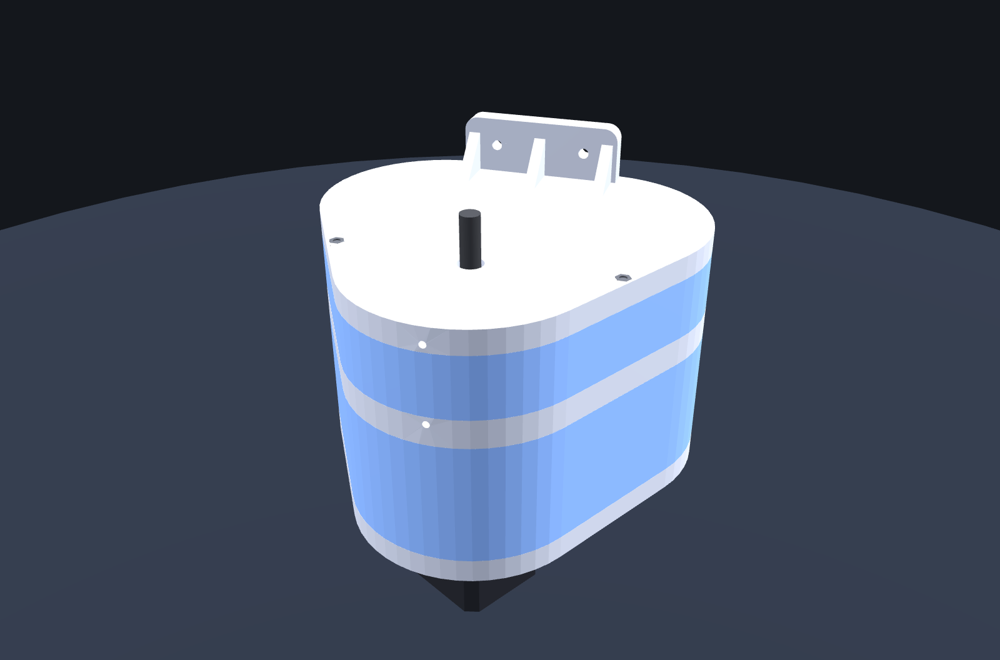
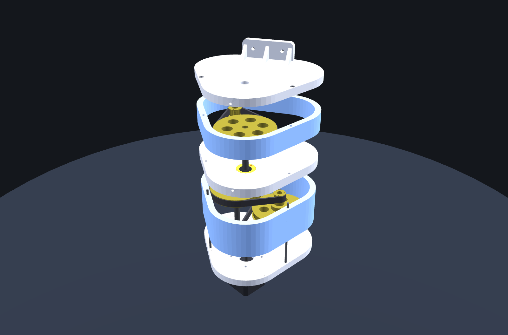

# 125:1 triple-belt gearbox for Dobsonian drives

3D-printed **125:1 reduction gearbox** (HTD 3M, 80T/16T pulleys, NEMA 17, adjustable belt tension) to motorise the altitude and azimuth axes of a Dobsonian telescope. Free, **CC BY-NC 4.0** (see `LICENSE`).

Three identical belt stages (5:1 each) are arranged in an equilateral triangle: same centre distance, same 288 mm belt on every stage, and the output shaft is coaxial with the motor shaft.

| | |
|---|---|
| Reduction | 5 x 5 x 5 = **125:1** |
| Pulleys / belts | 3 x HTD 3M 80T + 3 x 16T (10 mm wide) / 3 x HTD 3M **288 mm**, 10 mm |
| Centre distance | 64.79 mm |
| Footprint / height | 166.8 x 158.1 mm / 110 mm (158 mm with flanges) |
| Motor | NEMA 17 (42.3 x 42.3 x 40 mm), 5 mm shaft |
| Output | 8 mm shaft, 20 mm protruding |
| Belt tension | printed eccentric rings (1.5 mm), locked by a radial M3 screw |

## Contents
- `stl/`, `step/` — printed parts and full assembly. ALT variant: `1_base` + `5_cover`. AZ variant (upside-down, ears on the cover): `1_base_AZ_no_ears` + `5_cover_AZ`. Common: `2_walls_stage_1_2`, `3_plate`, `4_walls_stage_3`, `6_eccentric_ring_x6` (print 6).
- `viewer_3D.html` — standalone interactive 3D viewer (open in a browser) with exploded view and a dimensions table.
- `source/` — CadQuery source (`build_gearbox.py`; mounting parameters `MOUNT_SIDE`, `FL_*`, `EAR_*`). Rebuild with `python build_gearbox.py`, `python export_all.py`, then `python mesh_export.py` and `python make_html.py` (needs `cadquery` and a `three.min.js` r147 next to `make_html.py`, or set `THREE_JS`).
- `PARTS_LIST_FR.md` — liste d'achats (FR). Parts list (EN) below.

## Parts to buy (per gearbox, one gearbox per axis)
- 3 x HTD 3M pulley 80T, 10 mm width, 8 mm bore (flange dia <= 80 mm, hub height <= 8 mm)
- 3 x HTD 3M pulley 16T, 10 mm width (1 with 5 mm bore for the motor, 2 with 8 mm bore)
- 3 x HTD 3M closed belt 288-3M, 10 mm
- 6 x 688ZZ bearings (8 x 16 x 5), 300 mm of 8 mm ground shaft (cut 60.5 / 60.5 / 99 mm)
- 1 x NEMA 17, 4 x M3x12, 3 x M3 threaded rod 110 mm + 6 nuts, 6 x M3 cap screws ~40-45 mm (ring locking), wood screws dia 4 for mounting

## Status — please read
- Verified in CAD only (interference check of rings, 3D viewer tests). **Not test-printed yet.**
- The mounting flanges / ears are **not verified on a real rocker box**; adapt the parameters to your base.
- Three sourcing points to confirm on the pulleys you buy: 80T hub height (model: 6 mm), 16T with 8 mm bore, length of the ring-locking screws.
- The part that actually turns the telescope (friction wheel, belt or gear) is **not included**.

